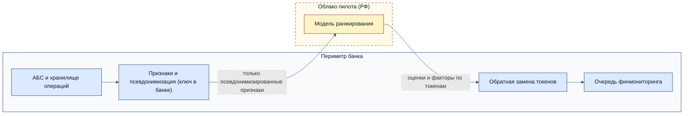

# ADR-001. Приоритизация очереди финмониторинга: ранжирование без учителя с контрольной выборкой; пилот в облаке на псевдонимизированных признаках, прод on-prem

Статус: предварительное  
Дата: 2026-10-12  
Инициатива: 1. Автоматически выявлять подозрительные операции по счетам (транзит, обналичивание, дробление платежей под пороги)

## Контекст

Правила и внешние сигналы помечают около 35 тыс. операций в месяц. Финмониторинг (25 сотрудников, 45 млн ₽ в год) разбирает около 10 тыс., в порядке суммы. Около 400 в месяц уходят на расследование; формально подтверждённых случаев — единицы, и появляются они через месяцы. Разметки «схема / не схема» нет. Исторически проверенные операции отобраны правилами и суммой, поэтому непроверенная операция не равна чистой.

Решение — сервис приоритизации ручной проверки: он меняет порядок очереди, вердикта не выносит. Постановка, качество, данные и эксперимент — разделы 2–5 паспорта ([02](02_problem_statement.md), [03](03_quality.md), [04](04_data_readiness.md), [05](05_experiment.md)).

## Жёсткие ограничения

1. Процедуры ПВК по выявлению и фиксированию операций не меняются. Модель не приостанавливает операции и не исключает операции из обязательного разбора.
2. Окончательную оценку риска даёт банк. Сигнал KYC-платформы — только вспомогательный признак.
3. Сырые данные операций под банковской тайной не покидают периметр банка. Любая передача наружу — только после вердикта комплаенса. Обработка и хранение — только в РФ.
4. Факт проверки и её причины не раскрываются клиенту.
5. Каждая оценка воспроизводима для аудита: версия модели, версия признаков, факторы. Хранение — в сроки 115-ФЗ.

## Рассмотренные варианты

### Источник сигнала

| Вариант | За | Против | Почему отклонён или выбран |
|---|---|---|---|
| Вероятностная контрольная выборка, размеченная экспертами | Единственная несмещённая оценка неразобранной части | При доле положительных в единицы процентов нужны десятки тысяч разметок для обучения; 12+ месяцев | Выбран как постоянный источник оценки и меток, но не как единственный путь к модели |
| Разметка финмониторингом по гайдлайну с оценкой согласованности | Чистые, согласованные метки; типология схем | Метки только там, где смотрели, — смещение отбора остаётся | Выбран как способ разметки и очереди, и контрольной выборки |
| Слабые метки: правила, внешние сигналы, эскалация, исход расследования | Быстро и дёшево, 400 эскалаций в месяц | Эскалация ≠ подтверждённая схема; обучение воспроизводит логику действующих правил | Отклонён как целевая переменная. Сигналы правил и KYC используются как признаки, исходы — для отчёта |
| Без учителя: ранжирование операций на ручную проверку | Не требует меток; старт сразу | Аномальное ≠ подозрительное; качество проверяется только разметкой | **Выбран** для пилота вместе с контрольной выборкой |

**Цена и сроки выбранного пути.** Около 120 ч экспертов в месяц (500 операций контрольной выборки, из них 100 независимо размечает второй сотрудник) — около 6% ёмкости разбора (2 000 ч в месяц). Обучаемый ранжировщик появится не раньше чем через 6–9 месяцев: 1–2 месяца на гайдлайн и согласованность, затем около 5 месяцев, пока в контрольной выборке наберётся 50 положительных для честной оценки (около 10 в месяц при доле 2%). До этого бизнес-эффект ограничен качеством ранжирования без учителя.

### Размещение

| Вариант | За | Против | Почему отклонён или выбран |
|---|---|---|---|
| Публичный API | — | Данные под банковской тайной у третьей стороны; LLM для табличного ранжирования не нужна | Отсечён ограничением 3 |
| Выделенный контур провайдера моделей | — | Те же проблемы с данными; готовой модели под задачу нет | Отсечён ограничением 3 |
| Self-hosting в российском облаке | Быстрый старт без закупки; эластичные ресурсы для расчёта графа | Данные за периметром; нужен вердикт комплаенса и псевдонимизация | **Выбран для пилота** — только псевдонимизированные признаки, при положительном вердикте комплаенса |
| On-prem | Данные в периметре; интеграция с АБС и системой ПОД/ФТ; достаточно CPU | Старт пилота зависит от выделения мощностей и песочницы | **Выбран для прода**; резервный вариант для пилота |
| Гибрид по звеньям | Чувствительное остаётся внутри | Сложнее в эксплуатации; звеньев, требующих внешних ресурсов, в проде нет | Применён только на пилоте: признаки и псевдонимизация — в банке, расчёт — в облаке |

### Модель

| Вариант | За | Против | Почему отклонён или выбран |
|---|---|---|---|
| Детерминированный скор правил и KYC | Прозрачен, без меток | Повторяет логику правил | Baseline |
| Модель аномалий по профилю клиента + текстовые признаки | Без меток, CPU, объяснима | Аномальное ≠ подозрительное | **Шортлист, пилот** |
| То же + графовые признаки контрагентов | Видит транзитные цепочки | Пересчёт графа по 20–25 млн операций в месяц | **Шортлист, пилот**; остаётся при приросте ≥ 10% |
| Бустинг-ранжировщик (CatBoost / LightGBM) на экспертных метках | Сильнее при наличии меток | Меток пока нет | **Второй этап** |
| Нейросети последовательностей и графовые нейросети | Сильны на больших данных | Нужны тысячи надёжных меток и GPU, факторы для сотрудника получить сложно | Отсечены |
| LLM для назначения платежа | Понимает свободный текст | Недетерминированный результат, GPU; текстовые признаки (лемматизация, словари типологий, TF-IDF) дают то же дешевле | Отсечены |
| Внешний AML-скоринг как сервис | Готовое решение | Операции уходят к третьей стороне; оценку банк обязан делать сам | Отсечён ограничениями 2 и 3 |

Baseline для сравнения — текущий порядок «по сумме» и детерминированный скор правил и KYC.

## Решение

**Данные и сигнал (пилот и прод).** Гайдлайн разметки с типологией. Постоянная стратифицированная контрольная выборка — 500 операций в месяц в обход ранжирования. Разметка разобранной очереди по тому же гайдлайну. 20% операций контрольной выборки независимо размечают два сотрудника, расхождения разбирает старший эксперт; порог согласованности — Cohen's kappa ≥ 0,61. Метки «эскалация», «исход расследования» и «подтверждено» хранятся раздельно.

**Пилот.** Пакетный расчёт в теневом режиме, затем ограниченное применение к части очереди. В пилоте сравниваются четыре варианта порядка очереди: модель аномалий с графовыми признаками, та же модель без них и два baseline — текущий порядок «по сумме» и детерминированный скор правил и KYC. Инфраструктура — self-hosting в российском облаке: виртуальные машины или Kubernetes без проприетарных ML-сервисов провайдера. В облако уходят только псевдонимизированные признаки: токены клиента и контрагента (ключ остаётся в банке), суммы, даты, ОКВЭД, канал. Текстовые признаки назначения платежа считаются в банке. Условие запуска — положительный вердикт комплаенса по передаче признаков в облако ([04](04_data_readiness.md), «Право использовать»); иначе пилот идёт в песочнице on-prem.

**Целевой прод.** On-prem, CPU. Пакетный расчёт перед формированием дневной очереди, интеграция с системой ПОД/ФТ. Модель — победитель пилота; после накопления меток — бустинг-ранжировщик по процедуре ниже.

## Процедура выбора модели

Пороги - это допущения из раздела 3 паспорта. Качество кандидатов будет известно только после прогона на приёмочном наборе.

**Приёмочный набор** — около 3 тыс. размеченных операций (первые 3 месяца контрольной выборки плюс история). Плюс ретро-прогон на 12 месяцах помеченных операций (≈ 420 тыс.) для проверки работоспособности.

| Сценарий | Источник примеров | Минимум |
|---|---|---|
| Транзит; обналичивание; дробление под пороги | Эскалации с типом, подтверждённые случаи, контрольная выборка | По 50 положительных на типологию |
| Честные высокооборотные и сезонные клиенты | Снятые после разбора приостановки | 200 |
| Новые клиенты без истории (< 3 месяцев) | Контрольная выборка, ретро | 200 |
| Крупные разовые легитимные операции | Ретро: разобранные без эскалации | 200 |
| Обезличенное назначение («возврат», «займ», «по счёту») | Контрольная выборка | 100 |

**Метрики и пороги**

| Метрика | Порог | Откуда значение |
|---|---|---|
| Precision@K (доля эскалаций в верхних K) | ≥ 6% (×1,5 к baseline 4%) | Допущение о точке окупаемости |
| Оценка recall@K по контрольной выборке | Не ниже baseline, выше — в полосах малых сумм | Гипотеза из раздела 5 паспорта: подозрительные операции есть и среди мелких сумм, порядок «по сумме» их пропускает |
| Доля каждой типологии в верхних K | Не ниже baseline ни по одной | Модель не ухудшает то, что уже работает |
| Доля снятых приостановок в верхних K | Не выше baseline | Guardrail по приостановкам и жалобам |
| Подтверждённые случаи вне верхних K | Разбор каждого | Случаев единицы, процент бессмыслен |
| Факторы приоритета у каждой операции | 100% | Жёсткое требование |
| Прирост от графовых признаков | ≥ +10% к precision@K модели без графа | Допущение: иначе пересчёт графа не окупается |

**Что означает провал на сценарии**

| Провал | Действие |
|---|---|
| Дробление ниже baseline: модель не видит серий под порогом | Операции, помеченные правилами дробления, ставятся в очередь на фиксированное место независимо от оценки модели; в модель добавляются признаки серий платежей за окно (число и сумма платежей одному контрагенту за 1–7 дней, доля платежей чуть ниже порога). Модель целиком не отклоняется, если по другим типологиям она лучше baseline |
| Операций, по которым приостановка потом была снята (честные клиенты), в верхних K больше, чем у baseline: модель принимает высокий оборот или сезонные всплески честных клиентов за подозрительность — вырастут лишние приостановки и жалобы | Блокер пилота для кандидата |
| Перекос на новых клиентов | Нормализация внутри сегмента; без исправления — блокер |
| Подтверждённые случаи вне верхних K системно | Остановка |

**Когда решение меняется**

- Ни один кандидат не даёт ×1,2 к baseline → в пилот идёт детерминированный скор правил, метки продолжают копиться.
- Графовые признаки дают меньше +10% → граф исключается.
- Накоплено ≥ 300 положительных меток по гайдлайну, из них ≥ 50 в контрольной выборке, при Cohen's kappa ≥ 0,61 → обучаем бустинг-ранжировщик с поправкой на смещение отбора очереди. Он заменяет модель аномалий при приросте precision@K на контрольной выборке ≥ 20% относительно неё. 300 и 50 — оценки, уточняются по кривой обучения.
- Модель аномалий выигрывает у бустинга → бустинг переобучился на логику правил; остаёмся на модели аномалий.

## Допущения

| Допущение | Источник | Критично для вывода |
|---|---|---|
| Комплаенс допустит передачу псевдонимизированных признаков в облако | Ожидание, вердикта нет | Да: иначе пилот on-prem, старт сдвигается на 1–2 месяца |
| Доля подозрительных в неразобранной части не меньше половины от 4% | Гипотеза из раздела 5 паспорта | Да: иначе смена порядка очереди мало что даст — в неразобранной части почти нечего находить |
| Финмониторинг выделит около 120 ч в месяц на разметку без потери обязательного разбора | Оценка | Да |
| Cohen's kappa ≥ 0,61 достижима после 1–2 итераций гайдлайна | Оценка; проверяется на первом месяце: 100 операций контрольной выборки независимо размечают два сотрудника | Да |
| Ёмкость расследований выдержит рост с 400 до примерно 540 случаев в месяц | Из контекста; не проверено | Да, для guardrail |
| Операции, обязательные к разбору по ПВК, — небольшая доля от 10 тыс. | Оценка | Нет |
| Расчёт графа по 20–25 млн операций в месяц укладывается в ночное окно на CPU | Оценка | Нет |

## Риски и что с ними делаем

| Риск | Что делаем |
|---|---|
| Модель воспроизводит логику правил | Эскалации не используются как целевая переменная; качество меряем на контрольной выборке |
| Новое смещение отбора от очереди модели | Контрольная выборка постоянная и идёт в обход модели |
| Несогласованная разметка | Гайдлайн, независимая разметка части операций двумя сотрудниками, калибровочные сессии разметчиков |
| Повторная идентификация по псевдонимизированным признакам | Минимум полей, округление сумм, ключ только в банке, удаление данных в облаке по окончании пилота с актом |
| Перегрузка расследований | Мониторинг нагрузки; рабочая точка K корректируется |
| Клиенты, проводящие схемы, адаптируются | Правила ПВК остаются; переобучение и пересмотр признаков ежеквартально |

## План выхода

Используются только открытые библиотеки (scikit-learn, CatBoost или LightGBM, библиотека графов) и контейнеры с описанием инфраструктуры кодом, без проприетарных сервисов облака. Если провайдер меняет условия или уходит: пилот переносится в песочницу on-prem, данные удаляются у провайдера с подтверждающим актом. Прод on-prem от облачного провайдера не зависит. При смене KYC-платформы признак отключается, модель переобучается.

## Триггеры пересмотра

- Отрицательный вердикт комплаенса по передаче признаков в облако.
- Контрольная выборка показывает долю подозрительных в неразобранной части < 2%.
- Бизнес решает искать схемы и в непомеченном потоке (20–25 млн операций в месяц).
- Новые сегменты клиентов или типологии схем; падение precision@K на контрольной выборке два месяца подряд.
- Изменение ПВК или требований регулятора к автоматизированным системам ПОД/ФТ.

## История

- v0.1 2026-10-12 — Предварительное решение: источник сигнала (ранжирование без учителя + контрольная выборка + разметка по гайдлайну), размещение (пилот — self-hosting в облаке на псевдонимизированных признаках, прод — on-prem), шортлист моделей.
